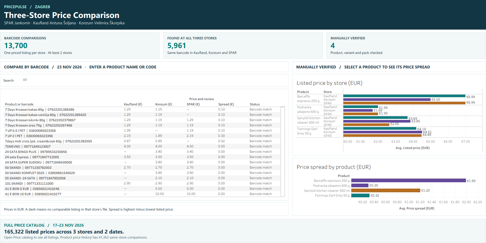
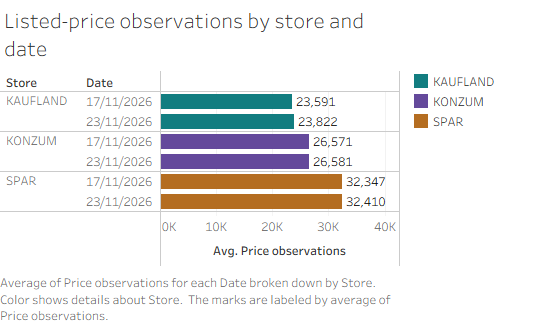
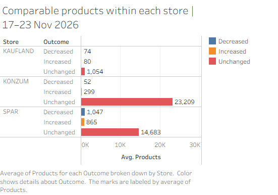

# PricePulse — Inteligencia de precios de supermercado

[English](README.md) · **Español**

PricePulse es un **proyecto de portafolio de ingeniería de datos**. Recopila listas oficiales de precios de supermercados croatas con Scrapy, valida identificadores de producto, guarda observaciones históricas en PostgreSQL y analiza ofertas comparables en Tableau.

**Estado al 25 de noviembre de 2026.** El portafolio público está completo. Las fases 0–2, 4 y 5 están cerradas. La fase 3 sigue abierta para verificar la captura automática y obtener la revisión del responsable del proyecto. Consulta el [estado actual](docs/es/CURRENT_STATE.md).

## Explora el panel de Tableau

Descarga el [libro interactivo de Tableau](portfolio/tableau/PricePulse-Three-Store-Price-Comparison.twbx?raw=true) y ábrelo con Tableau Desktop Public Edition 2026.3 o posterior. El archivo incluye los extractos de datos. Pulsa **F7** para entrar en modo presentación.

Busca por nombre o código de barras entre **13.700 coincidencias** de las listas del 23 de noviembre. **5.961** códigos tienen precios en las tres tiendas. Abre **Price catalog** para consultar **165.322 precios publicados** los días 17 y 23 de noviembre de 2026. [Búsqueda en modo presentación](portfolio/tableau/search-presentation.jpg) · [Guía de Tableau](docs/es/TABLEAU.md)



### Otras vistas del mismo libro

**Catalog coverage** muestra cuántos precios aporta cada tienda en cada fecha.



**Price changes by store** cuenta los productos comparables cuyo precio subió, bajó o se mantuvo entre ambas fechas en la misma tienda.



## Qué preguntas aborda PricePulse

- ¿Cómo cambia con el tiempo el precio publicado de un mismo producto?
- ¿Cuál es la diferencia de precio para el mismo GTIN/EAN verificado entre tiendas y fechas comparables?
- ¿Qué categorías presentan los mayores cambios o diferencias de precio?
- ¿Qué tan completas y confiables son las listas de precios de los comercios?

Las listas no contienen un campo obligatorio de existencias. La ausencia de un producto en una lista no permite inferir que esté agotado.

## Por qué estas fuentes

Los comercios croatas publican listas oficiales legibles por máquina. La regulación vigente desde el **17 de noviembre de 2026** contempla su recopilación automatizada y la publicación en CSV o XML. Las pruebas iniciales se documentan en [validación](docs/es/VALIDATION.md) y [viabilidad de las fuentes](docs/es/SOURCE_FEASIBILITY.md).

El libro usa las listas del 17 y 23 de noviembre de 2026 de SPAR Zagreb Jankomir (8702), Kaufland Zagreb Antuna Šoljana (5630) y Konzum Zagreb Velimira Škorpika (1280). [Listas de SPAR](https://www.spar.hr/usluge/cjenici) · [Listas de Kaufland](https://www.kaufland.hr/akcije-novosti/popis-mpc.html) · [Listas de Konzum](https://www.konzum.hr/cjenici)

## Inicio rápido en Windows PowerShell

Instala Git y [uv](https://docs.astral.sh/uv/). La configuración con dependencias fijadas usa Python 3.12.

```powershell
git clone https://github.com/angel-wm/pricepulse-retail-intelligence.git
Set-Location pricepulse-retail-intelligence
uv sync --locked --python 3.12
uv run --locked python --version
uv run --locked scrapy version
uv run --locked python -m pytest -q
```

Las pruebas de integración se omiten si `PRICEPULSE_TEST_DSN` no apunta a una base de pruebas desechable. Puedes crearla con [Docker Compose](docs/es/POSTGRESQL.md#postgresql-local-con-docker-compose) o [usar una existente](docs/es/POSTGRESQL.md#validación).

Para reproducir el flujo con archivos reales, consulta [adquisición](docs/es/ACQUISITION.md), [carga en PostgreSQL](docs/es/POSTGRESQL.md) y [exportación a Tableau](docs/es/TABLEAU.md#exportación-analítica-privada).

## Fases del proyecto

- **Fase 0 · Viabilidad, cerrada el 19 de noviembre.** Acceso acotado a las fuentes, historial de dos fechas y revisión de descripciones de productos.
- **Fase 1 · Adquisición con Scrapy, cerrada el 22 de noviembre.** Descubrimiento y descarga controlada de listas, con contratos de análisis y tratamiento de errores.
- **Fase 2 · Ingeniería de datos, cerrada el 23 de noviembre.** Procedencia y hash de cada archivo, análisis específico por fuente y observaciones históricas versionadas en PostgreSQL.
- **Fase 3 · Fiabilidad, pendiente de revisión.** Registro de ejecuciones, recuperación, programación local y señales provisionales de calidad.
- **Fase 4 · Analítica con Tableau, cerrada el 23 de noviembre.** Comparaciones de precios, cobertura e historial de precios por tienda.
- **Fase 5 · Validación y publicación, cerrada el 25 de noviembre.** Flujo validado, configuración local reproducible y portafolio de Tableau publicado.

Consulta la [hoja de ruta](docs/es/ROADMAP.md) para ver las condiciones de cierre de cada fase.

## Documentación

| Tema | Lectura |
| --- | --- |
| Alcance y estado | [Estado actual](docs/es/CURRENT_STATE.md) · [Especificación](docs/es/PROJECT_SPEC.md) · [Hoja de ruta](docs/es/ROADMAP.md) |
| Diseño y decisiones | [Arquitectura](docs/es/ARCHITECTURE.md) · [Decisiones](docs/es/DECISIONS.md) |
| Operación local | [Adquisición](docs/es/ACQUISITION.md) · [PostgreSQL](docs/es/POSTGRESQL.md) · [Fiabilidad](docs/es/RELIABILITY.md) |
| Análisis y comprobaciones | [Tableau](docs/es/TABLEAU.md) · [Viabilidad de las fuentes](docs/es/SOURCE_FEASIBILITY.md) · [Validación](docs/es/VALIDATION.md) |
| Navegación técnica | [Contexto del repositorio](docs/es/REPO_CONTEXT.md) |

El flujo utiliza Python 3.12, uv y Scrapy para la adquisición, PostgreSQL y SQL para el procesamiento histórico, pytest y GitHub Actions para las comprobaciones, y Tableau para el análisis visual. La documentación original en inglés es la referencia canónica.

## Licencia

El código y la documentación propios se ofrecen bajo la [licencia MIT](LICENSE). Los datos y las marcas de terceros siguen sujetos a los derechos y condiciones de sus titulares.
