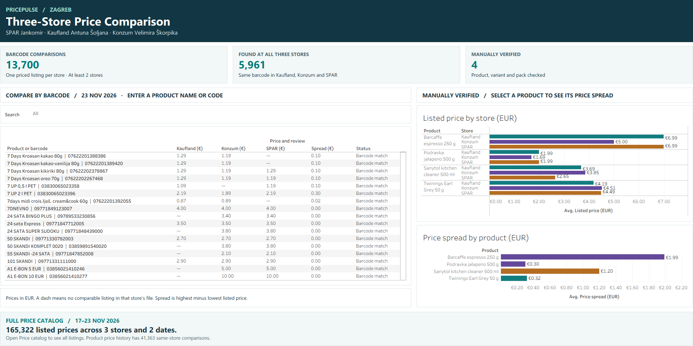

# PricePulse — Grocery Price Intelligence

PricePulse is a **documentation-first Data Engineering portfolio project** to acquire official Croatian grocery price-list files responsibly with Scrapy, validate product identities, store durable historical observations in PostgreSQL, and analyze comparable offers in Tableau.

**Current status (2026-11-25): Phase 5 validation is in progress.** Phases 0–2 and Phase 4 are closed. Phase 3 remains open for review of normal operation. See [Current state](CURRENT_STATE.md).

## Explore the Tableau dashboard

Download the [interactive Tableau workbook](portfolio/tableau/PricePulse-Three-Store-Price-Comparison.twbx?raw=true) and open it in Tableau Desktop Public Edition 2026.3 or later. The package includes the data extracts. Press **F7** for presentation mode.

Search by product name or barcode across **13,700 matches** from the 23 November price lists. **5,961** codes have prices in all three stores. Open **Price catalog** for **165,322 listed prices** across 17 and 23 November 2026. [Search in presentation mode](portfolio/tableau/search-presentation.jpg) · [Tableau guide](TABLEAU.md)



## What PricePulse aims to answer

- How do published prices for the same grocery product change over time?
- What is the price difference for the same verified GTIN/EAN across comparable stores and dates?
- Which product categories show the largest price changes or cross-retailer spreads?
- How complete and reliable are daily retailer price-list publications?

**Availability/stock tracking is not an initial KPI:** the governing regulation does not require an explicit stock field. A product missing from a list must not be described as out of stock.

## Why this data source?

Croatian retailers publish official machine-readable price lists. The regulation effective **17 November 2026** expressly provides for automated collection and CSV/XML price lists. This is stronger evidence for the acquisition use case than attempting to crawl individual product pages protected by anti-bot systems.

See [Validation](VALIDATION.md) and [Source feasibility](SOURCE_FEASIBILITY.md) for the source-access checks, two-date history, and product matching evidence.

### Data sources

The Tableau snapshot uses official price lists for SPAR Zagreb Jankomir (8702), Kaufland Zagreb Antuna Šoljana (5630) and Konzum Zagreb Velimira Škorpika (1280) for 17 and 23 November 2026. [SPAR price lists](https://www.spar.hr/usluge/cjenici) · [Kaufland price lists](https://www.kaufland.hr/akcije-novosti/popis-mpc.html) · [Konzum price lists](https://www.konzum.hr/cjenici)

## Local quick start (Windows PowerShell)

Install Git and [uv](https://docs.astral.sh/uv/), then run these commands in PowerShell. The locked setup targets Python 3.12.

```powershell
git clone https://github.com/angel-wm/pricepulse-retail-intelligence.git
Set-Location pricepulse-retail-intelligence
uv sync --locked --python 3.12
uv run --locked python --version
uv run --locked scrapy version
uv run --locked python -m pytest -q
```

The initial test run skips PostgreSQL integration cases unless `PRICEPULSE_TEST_DSN` points to a disposable database. Use the [Docker Compose setup](POSTGRESQL.md#local-postgresql-with-docker-compose) for local development and full integration tests, or [supply an existing disposable database](POSTGRESQL.md#validation).

For local runs with genuine data, follow the [acquisition](ACQUISITION.md), [ingestion](POSTGRESQL.md) and [Tableau export](TABLEAU.md#private-analytical-export) guides.

## Planned workflow

1. **Phase 0 — Feasibility:** bounded source access, two-date per-store price history, price-field parsing, and at least 100 descriptor-consistent product pairs — **formally closed on 2026-11-19**.
2. **Phase 1 — Scrapy (closed 2026-11-22):** two source-specific spiders discover SPAR's dated JSON manifests and Kaufland's asset index, then fetch permitted store price lists with bounded request rates and explicit parsing/error contracts.
3. **Phase 2 — Data engineering (closed 2026-11-23):** preserve file provenance and hashes; parse **SPAR cp1250/semicolon** and **Kaufland UTF-8 BOM/tab** sources; handle regular/special price origins, GTIN and package checks, and ingest versioned, deduplicated store/date observations into PostgreSQL.
4. **Phase 3 — Reliability (awaiting owner review):** run evidence, recovery, local scheduling and provisional quality monitoring are implemented; see [Reliability](RELIABILITY.md).
5. **Phase 4 — Tableau (closed):** compare cross-store prices and explore catalog coverage and same-store price history. See [Tableau analytics](TABLEAU.md).
6. **Phase 5 — Validation and release (in progress):** verify the complete workflow, document reproduction and prepare the portfolio release.

These phases mix completed work and planned deliverables; [Current state](CURRENT_STATE.md) and [Validation](VALIDATION.md) describe the implemented scope and its evidence.

## Technology

| Responsibility | Planned choice |
| --- | --- |
| Acquisition | Python 3.12, Scrapy, uv |
| File parsing and validation | Python standard library initially; explicit data contracts |
| Database and transformations | PostgreSQL, SQL, Python |
| Testing and automation | pytest; GitHub Actions where feasible |
| BI | Tableau Desktop and Tableau Desktop Public Edition |
| Version control | Git and GitHub |

Scrapy remains the primary acquisition framework. No additional scraping framework, paid service, or infrastructure is planned.

## Project references

- [Current state](CURRENT_STATE.md) — implemented versus pending work
- [Source feasibility](SOURCE_FEASIBILITY.md) — sources, evidence, tests, risks, and acceptance gates
- [Project specification](PROJECT_SPEC.md) — analytical scope and data contract
- [Roadmap](ROADMAP.md) — phase gates
- [Architecture](ARCHITECTURE.md) — proposed design
- [PostgreSQL](POSTGRESQL.md) — local ingestion, review and validation
- [Reliability](RELIABILITY.md) — run evidence, quality and schedule planning
- [Decisions](DECISIONS.md) — recorded decisions
- [Validation](VALIDATION.md) — actual evidence and outstanding tests
- [Repository context](REPO_CONTEXT.md) and [agent instructions](AGENTS.md) — navigation and working conventions

Repository documentation follows [Repository Documentation Readability](https://github.com/angel-wm/repository-documentation-readability). **Phase 0 was formally closed on 2026-11-19.** Phase 1 implementation was authorized on 2026-11-19; public release of genuine retailer data remains unapproved.

## License

Project-authored code and documentation are available under the [MIT License](LICENSE). Third-party data, trademarks, and other materials remain subject to their respective owners' rights and terms; this license does not grant permission to publish retailer data.
